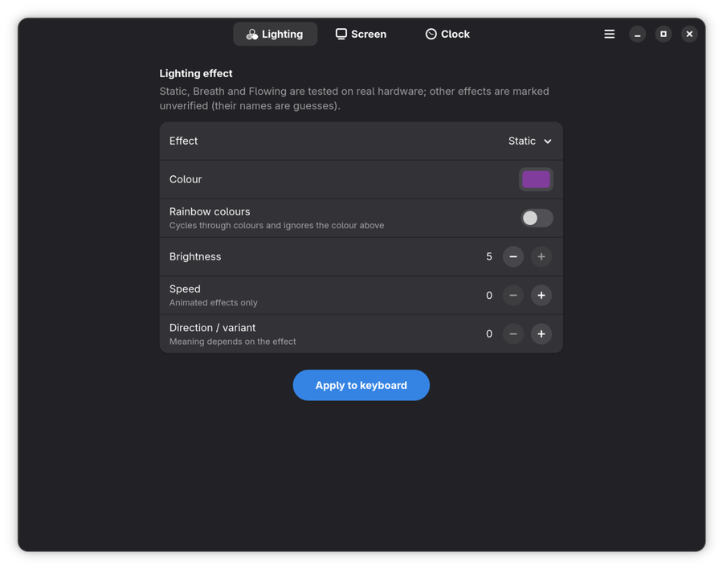
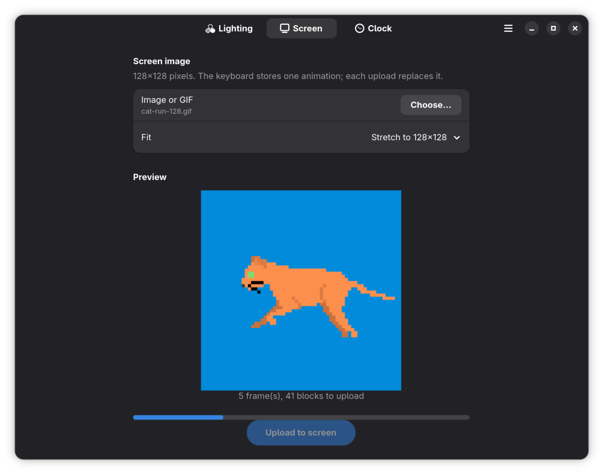
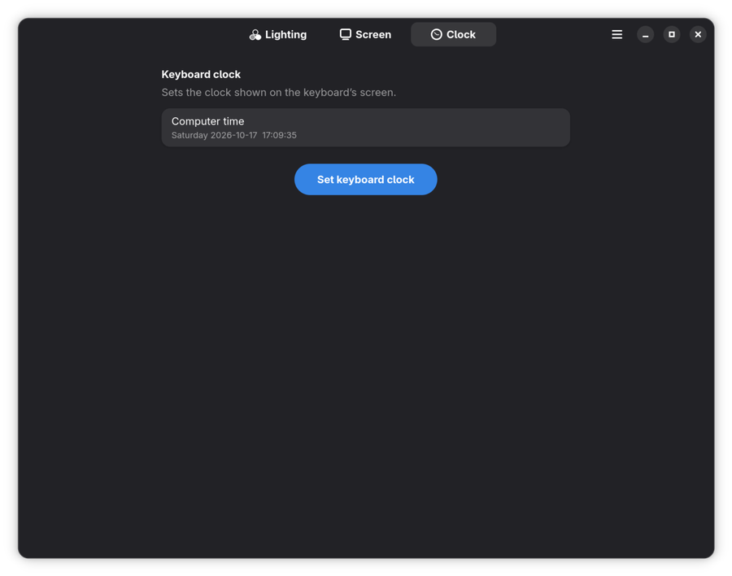

# ak820-linux

> **Unofficial and not fully tested.** This project is not affiliated with or endorsed by AJAZZ. It was developed with the help
> of Claude (an AI assistant) by observing the keyboard and its Windows configuration software, and tried on **one** keyboard.
> It writes settings to real hardware, so use it at your own risk. "AJAZZ" and "AK820 Pro" only name the supported device.

A small Linux app for the **AJAZZ AK820 Pro** keyboard (the model with the little colour screen). Instead of the
Windows-only vendor tool you can:

- change the **lighting** effect, colour, brightness and speed,
- upload an **image or GIF** to the keyboard's 128×128 screen,
- **sync the clock** shown on that screen.

It comes as a native GNOME app (GTK 4 / libadwaita) and as a command line tool.

<p>



</p>

## Quick start

1. **Build and install a package.** The included `Makefile` builds it inside a container, so you only need `podman` and `make`
   (`make help` lists the targets; `make packages` builds all three). Pick your distribution:

   | Distribution | Build | Install |
   |---|---|---|
   | Fedora | `make rpm` | `sudo dnf install ./dist/rpm/ak820-linux-*.noarch.rpm` |
   | Debian 13, Ubuntu 24.04+ (**untested**) | `make deb` (`make deb BASE=ubuntu:24.04` for Ubuntu) | `sudo apt install ./dist/deb/<base>/ak820-linux_*_all.deb` |
   | Arch Linux (**untested**) | `make arch` | `sudo pacman -U dist/arch/ak820-linux-*.pkg.tar.zst` |

   > The Debian/Ubuntu and Arch packages have **not been tested**: they were written but never built or installed. Only the
   > Fedora RPM has been built so far. If one fails, please open an issue with the output.

2. **Connect the keyboard with the USB cable** and replug it once (the package installs a udev rule that lets your desktop
   user access it without root).
3. **Start "AK820 Pro Configurator"** from the app grid, or run `ak820 gui`.

No keyboard at hand? `ak820 --demo gui` runs the app against a fake keyboard and sends nothing.

Command line examples:

```
ak820 devices                                   # is the keyboard found?
ak820 light 1 --rgb 00ff00 --brightness 5       # static green  (`ak820 light --list` shows the effects)
ak820 screen --image anim.gif --fit cover --go  # without --go it only shows what it would do
ak820 time                                      # set the keyboard clock
```

## What to expect

| | Status |
|---|---|
| Lighting (Static, Breath, Flowing; colour, rainbow, brightness, speed, direction) | checked on a real keyboard |
| Other lighting effects | same command, but their names are guesses (marked "unverified" in the app) |
| Screen image / GIF upload, clock sync | checked on a real keyboard |
| Key remapping | decoded but never tried, so **disabled** (code is in `ak820/keys.py`) |
| 2.4G dongle, Bluetooth, battery level, macros, Fn layer | **not supported** |

- Works over the **USB cable only**; with just the dongle connected the app shows a notice and disables its buttons.
- Tested on one keyboard (Fedora 44, GNOME). Other revisions or firmware may behave differently; nothing here touches the
  firmware, and a replug undoes settings.
- The Debian/Ubuntu and Arch packages are untested (see above).
- Requires libadwaita 1.5 or newer, so Debian 12 and Ubuntu 22.04 are too old.

If it works (or doesn't) on your keyboard, please open an issue with the output of `ak820 devices`.

## Development

```
make test                  # unit tests, no hardware needed (they use a fake device)
```

The protocol is documented in [`docs/PROTOCOL.md`](docs/PROTOCOL.md). When bumping the version, change it in `pyproject.toml`,
`ak820/__init__.py`, the RPM spec, `debian/changelog` and the PKGBUILD together; the container builds check that they agree.

## Licence

MIT, see [`LICENSE`](LICENSE). No vendor code or assets are included. `ak820/data/keys.json` is the key layout (names, HID usages,
positions) and is only used by the disabled key remap code.
